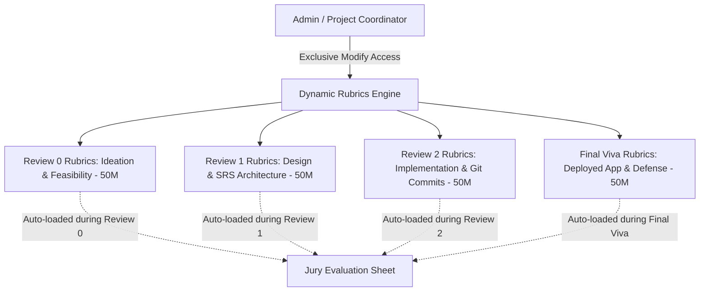

# Kongu Engineering College (Autonomous) — Department of Information Technology
# College Project Work Evaluation & Review Portal — System Architecture Document (v3.0)

---

## 1. Executive Summary & Feasibility Assessment

### 1.1 Institutional Context & Overview
**Production-ready Project Evaluation and Live Review Queue Orchestration Platform designed specifically for Kongu Engineering College (Autonomous), Perundurai — Department of Information Technology.**

Key Academic & Administrative Leadership:
- **Head of the Department (Super Admin)**: Dr. S. Varadhaganapathy (`KEC-IT-HOD`), Senior Professor & Head.
- **Evaluation Sheet Administrator (Admin)**: Mr. Senthilkumar (`KEC-IT-LA01`), Lab Assistant.
- **Review Panels**: 5 Concurrent Jury Panels across dedicated department laboratories, staffed by 15 faculty juries selected from the 30 official IT faculty directory.
- **Student Cohort**: 15 Capstone Project Teams (3 teams per panel), evaluated across progressive stages (*Review 0, Review 1, Review 2, Final Viva*).

### 1.2 System Purpose & Solved Problems
In engineering colleges and universities, project review days are chaotic:
- Students wait nervously in hallways for hours not knowing when their turn is.
- Juries lose time walking out of the lab or shouting names to call the next batch of students.
- Discrepancies in mark averaging across 3 independent jury members.
- Administrative delays compiling consolidated mark sheets.
- **Different review stages require fundamentally different criteria** (e.g., *Review 0* focuses on literature survey and feasibility, whereas *Review 2* and *Final Viva* focus on GitHub code quality and deployed live demos).

This system introduces **Live Review Queue Orchestration** alongside automated 3-jury rubric evaluation:
1. Each team receives an individual scheduled time slot.
2. Juries can trigger a **"Call Next / Standby Alert"** when the current team is nearing completion.
3. Students see a real-time status board: **Who is presenting now**, **Who is on standby**, and **When their turn is**.
4. Full triad of proof links: **GitHub Repository**, **Presentation PPT**, and **Live Deployed Output URL**.
5. **Phase-Specific Dynamic Rubrics**: Each review phase (*Review 0, Review 1, Review 2, Final Viva*) has its own dedicated rubric criteria (default 5 x 10 = 50 marks), **strictly modifiable ONLY by Admin Mr. Senthilkumar**.
6. **Strict Jury Panel Isolation**: Juries are cryptographically locked to their assigned panel and cannot jump to or view other panels.
7. Automated marks aggregation with 1-click Excel and PDF reports under HOD supervision.
8. Authoritative **Academic UI Design System** with tailored typography and status color codes.

---

## 2. Visual Identity & Design System Specification

### 2.1 Brand & Surface Color Palette
```css
:root {
  /* Brand Primary */
  --color-primary: #3730A3;        /* Royal Indigo: Authority, focus, and professionalism */
  --color-primary-hover: #312E81;
  --color-primary-light: #4338CA;

  /* Brand Accent */
  --color-accent: #7C3AED;         /* Violet: Creativity, innovation, and modern identity */
  --color-accent-hover: #6D28D9;
  --color-accent-light: #8B5CF6;

  /* Surfaces & Backgrounds */
  --color-bg-base: #F8FAFC;        /* Cool White: Clean, spacious, and organized */
  --color-bg-card: #FFFFFF;        /* Pure White: High contrast card containers */
  --color-bg-subtle: #F1F5F9;      /* Slate Tint: Input backgrounds, card headers */
  --color-highlight-soft: #E0E7FF; /* Pale Indigo: Selected cards, active filters */

  /* Text & Hierarchy */
  --color-text-main: #0F172A;      /* Slate 900: High-contrast primary headings */
  --color-text-body: #334155;      /* Slate Gray: Descriptions, rubric criteria, tables */
  --color-text-muted: #64748B;     /* Slate 500: Timestamps, hints, badges */
  --color-border: #E2E8F0;         /* Slate 200: Elegant borders */
}
```

### 2.2 Live Queue Status Color Tokens
| Status Badge | Text / Icon Color | Background Tint | Border Color | Meaning & Usage |
| :--- | :---: | :---: | :---: | :--- |
| **● Completed** | `#166534` (Forest Green) | `#DCFCE7` | `#86EFAC` | Team evaluation finished, marks locked |
| **● Standby** | `#92400E` (Amber Gold) | `#FEF3C7` | `#FCD34D` | Current team wrapping up; upcoming team alert |
| **● In Viva** | `#1D4ED8` (Royal Blue) | `#DBEAFE` | `#93C5FD` | Team currently presenting inside review room |
| **● Waiting** | `#475569` (Slate Gray) | `#F1F5F9` | `#CBD5E1` | Scheduled in queue, estimated slot shown |

### 2.3 Typography Stack
- **Plus Jakarta Sans**: Primary UI font used for dashboard headers, navigation, cards, modal dialogs, and button labels.
- **DM Sans**: Data-dense evaluation forms, rubric scoring sliders/inputs, and consolidated mark tables.
- **Outfit**: High-impact displays, statistics counters, total score badges (`48.5/50`), and student turn cards.

---

## 3. Review-Specific Dynamic Rubrics (Strictly Admin-Only)

Different phases of the project evaluate completely different competencies. The system provides **separate rubrics for each review phase**, and **ONLY the Admin has permission to create, edit, or adjust criteria and marks**:



### Standard Review Phase Rubrics Templates (5 × 10 = 50 Marks Each):

#### Phase 1: Review 0 (Problem Formulation & Literature Survey — 50 Marks)
1. **Problem Identification & Relevance** (10 Marks)
2. **Literature Review & Existing Work Study** (10 Marks)
3. **Proposed Objective & Methodology** (10 Marks)
4. **Feasibility Study & Work Plan** (10 Marks)
5. **Presentation (PPT) & Viva Voce** (10 Marks)

#### Phase 2: Review 1 (Design & Architecture — 50 Marks)
1. **System Architecture & Data Flow Design** (10 Marks)
2. **Module Specifications & Database Schema** (10 Marks)
3. **Hardware / Software Stack Selection** (10 Marks)
4. **Initial Prototype / Wireframes & Git Setup** (10 Marks)
5. **Presentation (PPT) & Viva Voce** (10 Marks)

#### Phase 3: Review 2 (Implementation & Testing — 50 Marks)
1. **Algorithm & Core Module Implementation** (10 Marks)
2. **Code Structure & GitHub Commit History** (10 Marks)
3. **Unit / Integration Testing & Results** (10 Marks)
4. **Partial Working Demo Verification** (10 Marks)
5. **Presentation (PPT) & Viva Voce** (10 Marks)

#### Phase 4: Final Review & Viva Voce (System Delivery & Defense — 50 Marks)
1. **Full Functional Completeness & Novelty** (10 Marks)
2. **Live Deployed Application Output Testing** (10 Marks)
3. **GitHub Code Quality, Architecture & Documentation** (10 Marks)
4. **Project Report / Documentation Standard** (10 Marks)
5. **Comprehensive Viva Voce & Defense** (10 Marks)

> **Strict Security & Access Control Rules:**
> 1. **Rubric Management Security**:
>    - **Admin (Mr. Senthilkumar)**: **Exclusive write/modify access** to add criteria, edit descriptions, adjust weights, and activate review phases.
>    - **Faculty / Jury**: Read-only rubric criteria; can only input scores between `0` and `maxMarks`.
>    - **Super Admin (Dr. S. Varadhaganapathy)**: Read-only audit access.
>    - **Student**: Cannot view rubric weights prior to evaluation; view-only after marks release.
> 2. **Strict Jury Panel Isolation Security**:
>    - **Faculty Juries are locked to their assigned panel.**
>    - A jury member assigned to Panel 01 can **ONLY view, monitor, and evaluate teams assigned to Panel 01**.
>    - **Cross-panel jumping is strictly blocked** in the UI and state filter: juries cannot browse other panels' queues, see other panels' teams, or enter marks for other panels.
>    - **Admin (Mr. Senthilkumar)** can switch between and configure all 5 panels via tabs.
>    - **Super Admin (Dr. S. Varadhaganapathy)** has an overarching **5-Panel Live Command Grid** and Consolidated Mark Sheet auditing all panels simultaneously.

---

## 4. Multi-Panel Departmental Architecture & Laboratory Allocation

The department evaluation operates 5 concurrent jury panels across physical computing laboratories:

| Panel | Laboratory Venue | Specialization Domain | 3-Member Faculty Jury | Assigned Teams |
| :--- | :--- | :--- | :--- | :--- |
| **Panel 01** | **IT Lab 4** (Ground Floor) | Cloud Computing & Web Technologies | **Jury 1**: Dr. J. Premalatha (Sr. Prof)<br>**Jury 2**: Dr. G. K. Kamalam (Sr. Assoc. Prof)<br>**Jury 3**: Dr. R. Shanthakumari (Assoc. Prof) | `T-IT-01`: Edge AI Smart Grid<br>`T-IT-02`: MedVision Diagnostics<br>`T-IT-03`: Zero-Trust Supply Chain |
| **Panel 02** | **IT Lab 2** (First Floor) | Artificial Intelligence & Machine Learning | **Jury 1**: Dr. S. Anandamurugan (Prof)<br>**Jury 2**: Dr. E. M. Roopa Devi (Assoc. Prof)<br>**Jury 3**: S. Vinothkumar (Asst. Prof SRG) | `T-IT-04`: GPS-Denied Drone<br>`T-IT-05`: Legal LLM Retrieval<br>`T-IT-06`: Federated EHR Privacy |
| **Panel 03** | **IT Lab 3** (First Floor) | Cyber Security & IoT Center | **Jury 1**: D. Vijay Anand (Asst. Prof SLG)<br>**Jury 2**: A. P. Ponselvakumar (Asst. Prof SLG)<br>**Jury 3**: Dr. V. Devisurya (Asst. Prof SLG) | `T-IT-07`: AI SCADA Defense<br>`T-IT-08`: Decentralized Threat Ledger<br>`T-IT-09`: Smart Contract Bytecode Audit |
| **Panel 04** | **IT Lab 1** (Ground Floor) | Mobile Computing & Full-Stack Systems | **Jury 1**: A. Jeevanantham (Asst. Prof SLG)<br>**Jury 2**: R. Aarthi (Asst. Prof SRG)<br>**Jury 3**: K. Sruthi (Asst. Prof) | `T-IT-10`: Disaster Mesh Network<br>`T-IT-11`: Edge AR Campus Navigation<br>`T-IT-12`: Smart Irrigation NPK IoT |
| **Panel 05** | **IT Seminar Hall B** (Second Floor) | Big Data Analytics & Cloud Infrastructure | **Jury 1**: S. Kavithra (Asst. Prof)<br>**Jury 2**: R. Sandhiya (Asst. Prof)<br>**Jury 3**: V. P. Gayathri (Asst. Prof) | `T-IT-13`: Genomic Pipeline Acceleration<br>`T-IT-14`: Ultra-Low Latency Order Matching<br>`T-IT-15`: TinyML Acoustic Predictive Maint |

---

## 5. High-Level System Architecture

```mermaid
graph TD
    subgraph Users & Portals
        S[Student Portal] -->|Submit GitHub, PPT, Live Demo| AUTH[Auth & Session Engine]
        JP1[Jury Panel 01] -->|Locked to Panel 01 Teams Only| AUTH
        JP2[Jury Panel 02] -->|Locked to Panel 02 Teams Only| AUTH
        JP3[Jury Panel 03..05] -->|Locked to Assigned Panel Only| AUTH
        ADM[Admin: Mr. Senthilkumar] -->|Rubrics Builder & 5-Panel Management| AUTH
        SADM[Super Admin: Dr. S. Varadhaganapathy] -->|5-Panel Command Center & Excel Audit| AUTH
    end

    subgraph Security & Isolation Layer
        AUTH --> RBAC[Role-Based Access Controller]
        RBAC --> ISOLATION[Strict Panel Isolation Filter]
    end

    subgraph Application Tier [React 19 + Context Engine]
        ISOLATION --> QUEUE_SVC[Live Review Queue & Standby Broadcast Engine]
        ISOLATION --> RUBRICS[Review-Specific Dynamic Rubrics (Admin Exclusive)]
        ISOLATION --> EVAL_SVC[3-Jury Score Aggregator (/50 Marks)]
        ISOLATION --> EXPORT[ExcelJS Consolidated Mark Sheet Engine]
    end
```

---

## 6. Role-Based Access Control (RBAC) Matrix

| Feature / Capability | Student | Faculty (Jury) | Admin (Mr. Senthilkumar) | Super Admin (Dr. S. Varadhaganapathy) |
| :--- | :---: | :---: | :---: | :---: |
| **Account Creation & Login** | Register with Roll No (`22ITR...`) | Pre-seeded Faculty ID | Pre-seeded (`KEC-IT-LA01`) | Pre-seeded (`KEC-IT-HOD`) |
| **Panel Isolation Rule** | 🔒 Own Panel Only | 🔒 **Strictly Assigned Panel Only (No Jumping)** | 🔄 Switch All 5 Panels | 🌐 Global 5-Panel Grid |
| **Team Registration (Mentor, Title, Teammates)** | ✅ Full (Sync for both) | ❌ Read-only | ✅ Override / View | ✅ Global View |
| **Submit Git, PPT & Deployed Demo Links** | ✅ Yes | ❌ Read-only | ❌ Read-only | ❌ Read-only |
| **Open & Test Git Repo, PPT & Deployed App** | ✅ Self | ✅ Click to Open All 3 | ✅ Click to Open All 3 | ✅ Click to Open All 3 |
| **View Live Panel Queue & "Who's Presenting"** | ✅ Own Panel Live | ✅ Own Panel Live | ✅ All 5 Panels | ✅ All 5 Panels |
| **Trigger "Call Next Team / Standby" Alert** | ❌ No | ✅ Yes (Assigned Panel Only) | ✅ Yes | ❌ No |
| **Mark Team as "Finished" & Advance Queue** | ❌ No | ✅ Yes (Assigned Panel Only) | ✅ Yes | ❌ No |
| **Update Review Venue & Broadcast Alert** | ❌ No | ✅ Yes (Assigned Panel Only) | ✅ Yes | ✅ View All |
| **Track & Update Project Progress %** | ✅ View / Submit | ✅ Update & Rate % | ✅ View | ✅ View |
| **Create & Modify Review-Specific Rubrics** | ❌ No | ❌ No | ✅ **Exclusive Write Access** | ❌ Read-only |
| **Schedule Time Slots & Assign Team Batches** | ❌ No | ❌ No | ✅ Full Control | ❌ Read-only |
| **Evaluate Active Phase Rubrics & Lock Marks** | ❌ No | ✅ Assigned Panel Teams Only | ❌ No | ❌ Read-only |
| **Real-time 3-Jury Score Aggregation** | ❌ No | ❌ Own Marks Only | ✅ Review Level | ✅ Global Real-Time |
| **Download Consolidated Mark Sheet (Excel/PDF)**| ❌ No | ❌ No | ❌ No | ✅ **1-Click Export** |

---

## 7. Report Generation Output Preview

### 7.1 Master Consolidated Mark Sheet Structure (Auto-Calculated by Panel)
| Team ID | Project Title | Teammate 1 (Roll) | Teammate 2 (Roll) | Mentor | Panel | Review Phase | Jury 1 (/50) | Jury 2 (/50) | Jury 3 (/50) | Panel Avg (/50) | Progress % | Verified Artifacts |
| :---: | :---: | :---: | :---: | :---: | :---: | :---: | :---: | :---: | :---: | :---: | :---: | :---: |
| **T-IT-01** | Autonomous Smart Grid Optimization | Yogeshwaran V (22ITR112) | Karthik R (22ITR045) | Dr. E. M. Roopa Devi | Panel 01 (IT Lab 4) | Review 2 | 47.0 | 45.0 | 46.0 | **46.00** | 85% | [Git](https://github.com/kec-it/smart-edge-grid) • [PPT](https://docs.google.com/presentation) • [Demo](https://smartgrid-edge.vercel.app) |
| **T-IT-02** | Real-time AI Medical Imaging Diagnosis | Deepika S (22ITR021) | Ananya M (22ITR008) | D. Vijay Anand | Panel 01 (IT Lab 4) | Review 2 | 48.0 | 47.0 | 49.0 | **48.00** | 90% | [Git](https://github.com/kec-it/med-vision-ai) • [PPT](https://docs.google.com/presentation) • [Demo](https://medvision-diagnosis.vercel.app) |
| **T-IT-04** | GPS-Denied Drone Path Navigation | Vigneshwaran S (22ITR105) | Pavithra M (22ITR064) | Dr. V. Devisurya | Panel 02 (IT Lab 2) | Review 2 | 46.0 | 45.0 | 47.0 | **46.00** | 80% | [Git](https://github.com/kec-it/autonomous-drone-slam) • [PPT](https://docs.google.com/presentation) • [Demo](https://drone-slam-vision.web.app) |
| **T-IT-07** | Zero-Day SCADA Intrusion Defense | Harish K (22ITR038) | Divya P (22ITR025) | S. Kavithra | Panel 03 (IT Lab 3) | Review 2 | 47.0 | 46.0 | 48.0 | **47.00** | 88% | [Git](https://github.com/kec-it/scada-zero-day-ids) • [PPT](https://docs.google.com/presentation) • [Demo](https://scada-defense.web.app) |
| **T-IT-10** | Decentralized Disaster Mesh Network | Sanjay B (22ITR092) | Nithish Kumar K (22ITR058) | K. Sruthi | Panel 04 (IT Lab 1) | Review 2 | 45.0 | 46.0 | 44.0 | **45.00** | 82% | [Git](https://github.com/kec-it/disaster-ble-mesh) • [PPT](https://docs.google.com/presentation) • [Demo](https://disaster-mesh.web.app) |
| **T-IT-13** | Accelerated Genomic Variant Pipeline | Ragul S (22ITR081) | Varun C (22ITR102) | V. P. Gayathri | Panel 05 (Seminar Hall B) | Review 2 | 48.0 | 47.0 | 49.0 | **48.00** | 92% | [Git](https://github.com/kec-it/genomic-wgs-pipeline) • [PPT](https://docs.google.com/presentation) • [Demo](https://genomic-pipeline.vercel.app) |
