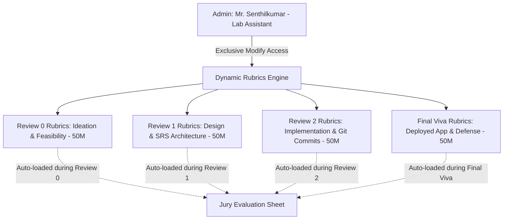
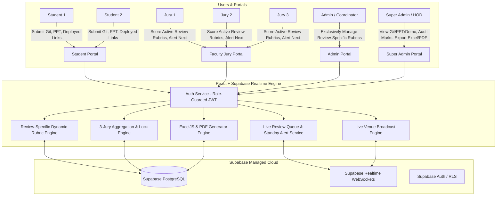

# College Project Work Evaluation System — Architecture & System Design Document (v2.6)

---

## 1. Executive Summary & Feasibility Assessment

### 1.1 Is this Project Feasible?
**Yes, 100% feasible, highly scalable, and production-ready for deployment with Supabase.**

In engineering colleges and universities, project review days are chaotic:
- Students wait nervously in hallways for hours not knowing when their turn is.
- Juries lose time walking out of the lab or shouting names to call the next batch of students.
- Discrepancies in mark averaging across 3 independent jury members.
- Administrative delays compiling consolidated mark sheets.
- **Different review stages require fundamentally different criteria** (e.g., *Review 0* focuses on literature survey and feasibility, whereas *Review 2* and *Final Viva* focus on GitHub code quality and deployed live demos).

This system introduces **Live Review Queue Orchestration** alongside automated 3-jury rubric evaluation:
1. Each team receives an individual scheduled time slot.
2. Juries can trigger a **"Call Next / Standby Alert"** when the current team is nearing completion.
3. Students see a real-time status board: **Who is presenting now**, **Who is on standby**, and **When their turn is**.
4. Full triad of proof links: **GitHub Repository**, **Presentation PPT**, and **Live Deployed Output URL**.
5. **Phase-Specific Dynamic Rubrics**: Each review phase (*Review 0, Review 1, Review 2, Final Viva*) has its own dedicated rubric criteria (default 5 x 10 = 50 marks), **strictly modifiable ONLY by the Admin**.
6. Automated marks aggregation with 1-click Excel and PDF reports.
7. Authoritative **Academic UI Design System** with tailored typography and status color codes.

---

## 2. Visual Identity & Design System Specification

### 2.1 Brand & Surface Color Palette
```css
:root {
  /* Brand Primary */
  --color-primary: #3730A3;        /* Royal Indigo: Authority, focus, and professionalism */
  --color-primary-hover: #312E81;
  --color-primary-light: #4338CA;

  /* Brand Accent */
  --color-accent: #7C3AED;         /* Violet: Creativity, innovation, and modern identity */
  --color-accent-hover: #6D28D9;
  --color-accent-light: #8B5CF6;

  /* Surfaces & Backgrounds */
  --color-bg-base: #F8FAFC;        /* Cool White: Clean, spacious, and organized */
  --color-bg-card: #FFFFFF;        /* Pure White: High contrast card containers */
  --color-bg-subtle: #F1F5F9;      /* Slate Tint: Input backgrounds, card headers */
  --color-highlight-soft: #E0E7FF; /* Pale Indigo: Selected cards, active filters */

  /* Text & Hierarchy */
  --color-text-main: #0F172A;      /* Slate 900: High-contrast primary headings */
  --color-text-body: #334155;      /* Slate Gray: Descriptions, rubric criteria, tables */
  --color-text-muted: #64748B;     /* Slate 500: Timestamps, hints, badges */
  --color-border: #E2E8F0;         /* Slate 200: Elegant borders */
}
```

### 2.2 Live Queue Status Color Tokens
| Status Badge | Text / Icon Color | Background Tint | Border Color | Meaning & Usage |
| :--- | :---: | :---: | :---: | :--- |
| **● Completed** | `#166534` (Forest Green) | `#DCFCE7` | `#86EFAC` | Team evaluation finished, marks locked |
| **● Standby** | `#92400E` (Amber Gold) | `#FEF3C7` | `#FCD34D` | Current team wrapping up; upcoming team alert |
| **● In Viva** | `#1D4ED8` (Royal Blue) | `#DBEAFE` | `#93C5FD` | Team currently presenting inside review room |
| **● Waiting** | `#475569` (Slate Gray) | `#F1F5F9` | `#CBD5E1` | Scheduled in queue, estimated slot shown |

### 2.3 Typography Stack
- **Plus Jakarta Sans**: Primary UI font used for dashboard headers, navigation, cards, modal dialogs, and button labels.
- **DM Sans**: Data-dense evaluation forms, rubric scoring sliders/inputs, and consolidated mark tables.
- **Outfit**: High-impact displays, statistics counters, total score badges (`48.5/50`), and student turn cards.

---

## 3. Review-Specific Dynamic Rubrics (Strictly Admin-Only)

Different phases of the project evaluate completely different competencies. The system provides **separate rubrics for each review phase**, and **ONLY the Admin has permission to create, edit, or adjust criteria and marks**:



### Standard Review Phase Rubrics Templates (5 × 10 = 50 Marks Each):

#### Phase 1: Review 0 (Problem Formulation & Literature Survey — 50 Marks)
1. **Problem Identification & Relevance** (10 Marks)
2. **Literature Review & Existing Work Study** (10 Marks)
3. **Proposed Objective & Methodology** (10 Marks)
4. **Feasibility Study & Work Plan** (10 Marks)
5. **Presentation (PPT) & Viva Voce** (10 Marks)

#### Phase 2: Review 1 (Design & Architecture — 50 Marks)
1. **System Architecture & Data Flow Design** (10 Marks)
2. **Module Specifications & Database Schema** (10 Marks)
3. **Hardware / Software Stack Selection** (10 Marks)
4. **Initial Prototype / Wireframes & Git Setup** (10 Marks)
5. **Presentation (PPT) & Viva Voce** (10 Marks)

#### Phase 3: Review 2 (Implementation & Testing — 50 Marks)
1. **Algorithm & Core Module Implementation** (10 Marks)
2. **Code Structure & GitHub Commit History** (10 Marks)
3. **Unit / Integration Testing & Results** (10 Marks)
4. **Partial Working Demo Verification** (10 Marks)
5. **Presentation (PPT) & Viva Voce** (10 Marks)

#### Phase 4: Final Review & Viva Voce (System Delivery & Defense — 50 Marks)
1. **Full Functional Completeness & Novelty** (10 Marks)
2. **Live Deployed Application Output Testing** (10 Marks)
3. **GitHub Code Quality, Architecture & Documentation** (10 Marks)
4. **Project Report / Documentation Standard** (10 Marks)
5. **Comprehensive Viva Voce & Defense** (10 Marks)

> **Strict Security Rule:**
> - **Student**: Cannot view rubric weights prior to evaluation; view-only after marks release.
> - **Faculty / Jury**: Read-only rubric criteria; can only input scores between `0` and `max_marks`. Cannot alter criteria or weights.
> - **Super Admin**: Read-only audit access.
> - **Admin**: **Exclusive write/modify access** to add criteria, edit descriptions, adjust marks, and activate review phases.

---

## 4. High-Level System Architecture



---

## 5. Role-Based Access Control (RBAC) Matrix

| Feature / Capability | Student | Faculty (Jury) | Admin (Mr. Senthilkumar · Lab Asst.) | Super Admin (HOD Dr. S. Varadhaganapathy) |
| :--- | :---: | :---: | :---: | :---: |
| **Account Creation & Login** | Register with Roll No | Pre-seeded / Faculty ID | Pre-seeded | Pre-seeded |
| **Team Registration (Mentor, Title, Teammates)** | ✅ Full (Sync for both) | ❌ Read-only | ✅ Override / View | ✅ Global View |
| **Submit Git, PPT & Deployed Demo Links** | ✅ Yes | ❌ Read-only | ❌ Read-only | ❌ Read-only |
| **Open & Test Git Repo, PPT & Deployed App** | ✅ Self | ✅ Click to Open All 3 | ✅ Click to Open All 3 | ✅ Click to Open All 3 |
| **View Live Panel Queue & "Who's Presenting"** | ✅ Own Panel Live | ✅ Own Panel Live | ✅ All Panels | ✅ All Panels |
| **Trigger "Call Next Team / Standby" Alert** | ❌ No | ✅ Yes (Assigned Panel) | ✅ Yes | ❌ No |
| **Mark Team as "Finished" & Advance Queue** | ❌ No | ✅ Yes (Assigned Panel) | ✅ Yes | ❌ No |
| **Update Review Venue & Broadcast Alert** | ❌ No | ✅ Yes (Assigned Panel) | ✅ Yes | ✅ View All |
| **Track & Update Project Progress %** | ✅ View / Submit | ✅ Update & Rate % | ✅ View | ✅ View |
| **Create & Modify Review-Specific Rubrics** | ❌ No | ❌ No | ✅ **Exclusive Access** | ❌ Read-only |
| **Schedule Time Slots & Assign Team Batches** | ❌ No | ❌ No | ✅ Full Control | ❌ Read-only |
| **Evaluate Active Phase Rubrics & Lock** | ❌ No | ✅ Assigned Teams Only | ❌ No | ❌ Read-only |
| **Real-time 3-Jury Score Aggregation** | ❌ No | ❌ Own Marks Only | ✅ Review Level | ✅ Global Real-Time |
| **Download Consolidated Mark Sheet (Excel/PDF)**| ❌ No | ❌ No | ❌ No | ✅ 1-Click Export |

---

## 6. Report Generation Output Preview

### 6.1 Excel (`.xlsx`) Export Structure (Auto-Calculated)
| Team ID | Project Title | Teammate 1 (Roll) | Teammate 2 (Roll) | Mentor | Panel | Review Phase | Jury 1 (/50) | Jury 2 (/50) | Jury 3 (/50) | Panel Avg (/50) | Progress % | Verified Artifacts |
| :---: | :---: | :---: | :---: | :---: | :---: | :---: | :---: | :---: | :---: | :---: | :---: | :---: |
| T-CS-01 | Autonomous Smart Grid | Alex (21CS01) | Brian (21CS02) | Dr. Ramesh | Panel 1 | Review 2 | 46.0 | 44.5 | 45.0 | **45.17** | 85% | [Git](https://github.com) • [PPT](https://slides.com) • [Demo](https://demo.app) |
| T-CS-02 | AI Medical Diagnostics | Claire (21CS05) | David (21CS06) | Prof. Priya | Panel 1 | Review 2 | 48.0 | 47.0 | 49.0 | **48.00** | 90% | [Git](https://github.com) • [PPT](https://slides.com) • [Demo](https://demo.app) |
| T-CS-03 | Cyber Threat Detection | Evan (21CS09) | Fiona (21CS10) | Dr. Suresh | Panel 1 | Review 2 | 42.0 | 43.0 | 41.5 | **42.17** | 70% | [Git](https://github.com) • [PPT](https://slides.com) • [Demo](https://demo.app) |
